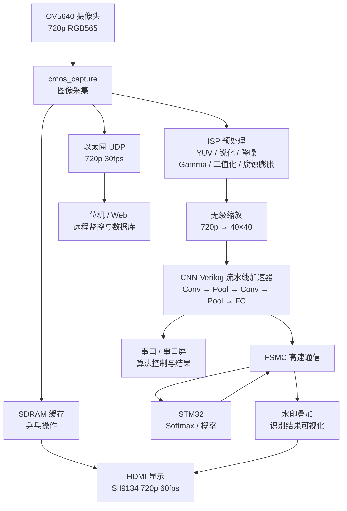
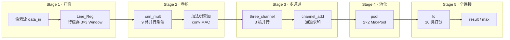

# CNN-Verilog

> **用 Verilog 实现的流水线（Pipeline）CNN 神经网络加速器**  
> 2025 年（第九届）全国大学生集成电路创新创业大赛 · **全国一等奖**

[]()
[]()
[]()
[]()

---

## 项目简介

本项目以 **纯 Verilog** 在国产 FPGA 上实现了一套完整的 **CNN 卷积神经网络流水线加速器**，并集成于「基于中科亿海微 FPGA 的智能售货系统」中，完成实时图像采集、预处理、CNN 分类识别与结果可视化。

**核心主张：CNN 不是靠软件库跑出来的，而是用 Verilog 一级一级搭出来的数据流流水线。**

卷积开窗、乘加、多通道累加、池化、全连接全部以硬件流水级组织，权重片上驻留、特征图片上流转，从架构上规避传统加速器「权重 / Feature Map 反复搬进 SDRAM」的存储墙问题，实现 **低延时、高吞吐、低功耗** 的边缘端 CNN 推理。

| 项目 | 内容 |
| --- | --- |
| 竞赛 | 第九届全国大学生集成电路创新创业大赛（中科亿海微杯） |
| 奖项 | **全国一等奖** |
| 队伍 | fpga冒险家 · `CICC0904951` |
| 作品 | 基于中科亿海微 FPGA 的智能售货系统 |
| 亮点 | **Verilog CNN · Pipeline 流水线 · 参数化 IP · 数据流架构** |

---

## 为什么是「Verilog + Pipeline」？

传统 CNN 加速器常见做法：

```text
权重  ──►  SDRAM  ──►  计算单元  ──►  SDRAM  ──►  下一层
中间 Feature Map 同样反复进出片外存储
```

问题：

- 带宽被搬运吃掉，算力空转
- 实时场景下 SDRAM 带宽不够
- 功耗高、延时大，对国产 FPGA EDA 与布线资源不友好

**本项目采用流水线数据流架构：**

```text
像素流 ──► 行缓存开窗 ──► 卷积 MAC ──► 通道累加 ──► 池化 ──► 下一级 ──► 全连接
              │            │           │          │         │
              └────────── 每一级都是流水线级，valid/data 随拍流动 ──────────┘
```

收益：

- **高吞吐**：层间流水，数据随 `valid` 信号连续流动
- **低延时**：单次 CNN 推理 **&lt; 0.135 ms**
- **低功耗 / 低存储压力**：权重与中间特征片上缓存，减少片外访存
- **可移植**：内部 IP 全部自主 Verilog 设计，可适配多款国产 FPGA

---

## 系统架构



数据分三路并行：

1. **显示通路**：OV5640 → SDRAM 乒乓缓存 → HDMI 720p 实时显示  
2. **识别通路**：预处理 → 无级缩放 → **Verilog CNN 流水线** → 分类结果叠加水印  
3. **传输通路**：以太网 UDP 将 720p 30fps 视频上传上位机 / Web  

---

## CNN 流水线架构（重点）

### 网络结构

```text
Input 40×40 (INT8)
        │
        ▼
┌───────────────────┐
│  Conv 3×3 ×3       │  Layer1: 1 → 3 通道
│  + MaxPool 2×2     │  参数化开窗 / 步长 / Padding
└─────────┬─────────┘
          ▼
┌───────────────────┐
│  Conv 3×3 ×3       │  Layer2: 3 → 3 通道
│  + MaxPool 2×2     │  多通道并行卷积 + 通道求和
└─────────┬─────────┘
          ▼
┌───────────────────┐
│  Fully Connected   │  10 分类
│  + ArgMax / Softmax│  Softmax 由 STM32 协同完成
└───────────────────┘
```

### 流水线数据通路



### 核心设计要点

| 设计点 | 说明 |
| --- | --- |
| **参数化卷积 IP** | `conv` 模块支持 kernel size / stride / padding / 位宽 / 核编号 `CORE` 等参数，一套代码覆盖多种配置 |
| **行缓存开窗** | `Line_Reg` 多行缓存 + 滑动窗口，连续输出 3×3 邻域，流式处理无需整帧缓存 |
| **并行 MAC** | `cnn_mult` 一次完成 9 路乘法，配合加法树实现卷积乘累加 |
| **多通道并行** | `three_channel` 实例化多个卷积核并行计算，`channel_add` 完成跨通道求和 |
| **流式池化** | `pool` 基于行缓冲与行列计数，奇数行奇数列触发 2×2 MaxPool，与前级流水对齐 |
| **全连接** | `fc` 片上权重 ROM + 乘累加，输出 10 类得分与最大类别 |
| **定点量化** | 卷积权重 INT8（1+8），全连接权重 15 位定点，偏置 8 位，兼顾精度与资源 |
| **数据流架构** | 各级以 `valid` 握手级联，形成端到端 Pipeline，显著提升吞吐率 |

### 性能指标

| 指标 | 数值 |
| --- | --- |
| 识别类别 | 10 类（交通标志等） |
| 浮点训练准确率 | **93.4%** |
| INT8 量化准确率 | **91.7%** |
| 板上实测平均准确率 | ~87%（复杂场景） |
| 单次推理延时 | **&lt; 0.135 ms** |
| 模型参数量 | ~3.2 KB |
| 单次计算量 | ~120 K MACC |
| 等效算力 | **0.889 GOPS** |
| 视频通路 | HDMI 720p **60 fps** |
| 网络通路 | 以太网 720p **30 fps** |

---

## 工程目录

```text
CNN-Verilog/
├── README.md
├── LICENSE
├── ov5640_hdmi_test.qpf          # Quartus 工程
├── ov5640_hdmi_test.qsf          # 引脚与工程约束
└── src/
    ├── ov5640_hdmi_1280x720.v    # 顶层模块
    ├── cnn/                      # ★ CNN 流水线加速器（核心）
    │   ├── cnn_top.v             # CNN 顶层
    │   ├── cnn_test.v            # 测试/展开结构
    │   ├── three_channel.v       # 多通道卷积
    │   ├── top.v                 # 单核 Conv+Pool
    │   ├── conv.v                # 参数化卷积
    │   ├── Line_Reg.v            # 行缓存 3×3 开窗
    │   ├── cnn_mult.v            # 并行乘法器
    │   ├── channel_add.v         # 通道求和
    │   ├── pool.v                # 2×2 MaxPool
    │   ├── fc.v                  # 全连接
    │   └── parameter*/           # 量化权重与偏置
    ├── isp/                      # 图像预处理
    │   ├── isp_rgb2yuv.v         # 色彩空间转换
    │   ├── isp_mid_filter.v      # 中值滤波降噪
    │   ├── isp_binary.v          # 二值化
    │   ├── ee/                   # 拉普拉斯锐化
    │   ├── erosion/ dilation/    # 腐蚀 / 膨胀
    │   ├── gamma/ contrast/      # Gamma / 对比度 LUT
    │   └── watermark_*           # 识别结果水印叠加
    ├── ov5640/                   # 摄像头驱动（I2C / SCCB）
    ├── hdmi/                     # HDMI 显示（SII9134 I2C + 时序）
    ├── sdram/                    # SDRAM 控制器与乒乓缓存
    ├── eth/                      # 以太网 UDP 发送
    ├── uart/                     # 串口收发
    ├── fsmc/                     # FPGA ↔ STM32 FSMC
    ├── ram/                      # 帧缓存 / CNN 控制
    └── key_control/              # 按键控制
```

---

## 快速上手

### 环境

- Intel / 国产兼容 Quartus 系列 EDA（工程文件为 `.qpf / .qsf`）
- 目标板卡：中科亿海微 Link-Sea-H6A 图像处理套件（或同资源国产 FPGA）
- 外设：OV5640 摄像头、SII9134 HDMI、STM32（FSMC）、RTL8211EG 以太网 PHY

### 步骤

1. 打开 `ov5640_hdmi_test.qpf`
2. 确认 `src/` 下 Verilog 源文件与 `cnn/parameter*/` 权重路径
3. 综合 / 布局布线 / 生成比特流
4. 上板后：
   - HDMI 输出 720p 实时画面  
   - 串口 / 串口屏下发算法控制  
   - 以太网上位机查看 720p 视频流  
   - CNN 识别结果经水印叠加显示  

### 更换 / 训练自己的权重

1. 用 PyTorch 训练同结构 CNN（Conv3×3 → Pool → Conv3×3 → Pool → FC10）
2. 将权重 **线性量化** 为定点补码（卷积 9 位、FC 15 位 / 偏置 8 位）
3. 导出为 `parameter/weight*.txt`、`bias.txt`（`$readmemb` 可读格式）
4. 重新综合即可替换识别类别

---

## 核心优势（竞赛评审四大亮点）

1. **CNN 参数化 IP 设计**  
   覆盖卷积、池化、激活等常见算子的参数调整，一套 IP 多场景复用。

2. **CNN 流水线（Pipeline）架构**  
   层间流水、数据流组织，显著提高吞吐率，低消耗、低延时，降低对 FPGA EDA 的压力，更好适配国产平台。

3. **CNN 内部 IP 完全自主 Verilog 设计**  
   不依赖第三方 CNN IP，可移植性强，可适配多种国产 FPGA。

4. **定制化 User Port**  
   对外接口简洁，降低使用门槛，便于二次开发与系统集成。

---

## 团队

**队伍名称**：fpga冒险家　**队伍编号**：CICC0904951

| 成员 | 分工 |
| --- | --- |
| 周钰霖 | CNN 仿真与移植、网口及 Web 端搭建 |
| 叶炜斌 | 数据流搭建与时序优化 |
| 朱翔宇 | CNN 训练以及 FSMC 通信 |

> 备赛期间历时约四个月。未来我们将继续开源核心代码，与更多开发者交流，助力国产 FPGA 生态发展。

---

## 获奖

**2025 年（第九届）全国大学生集成电路创新创业大赛 — 全国一等奖**

作品名称：基于中科亿海微 FPGA 的智能售货系统  
参赛杯赛：中科亿海微杯

---

## License

本项目采用 [MIT License](LICENSE) 开源，欢迎学习、交流与二次开发。

若本项目对你有帮助，欢迎 Star ⭐ 支持！
